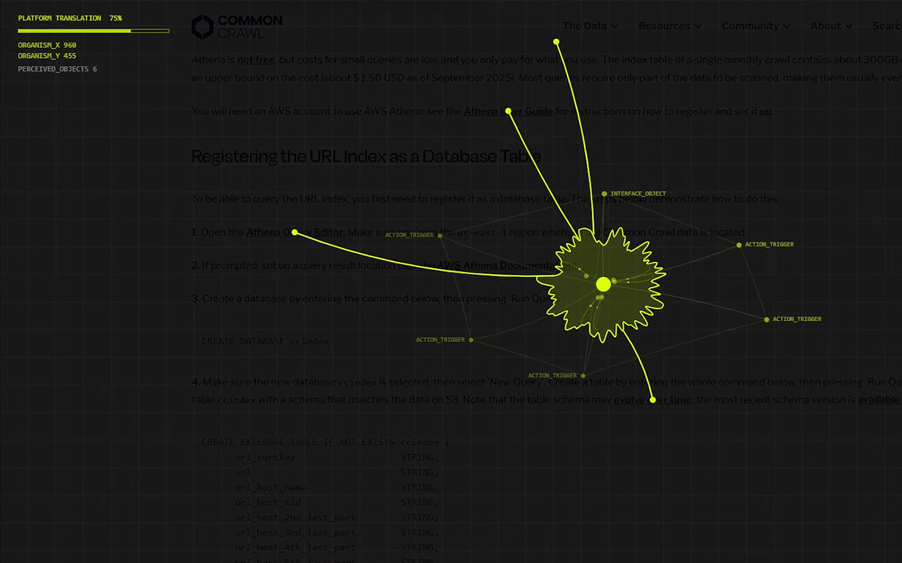
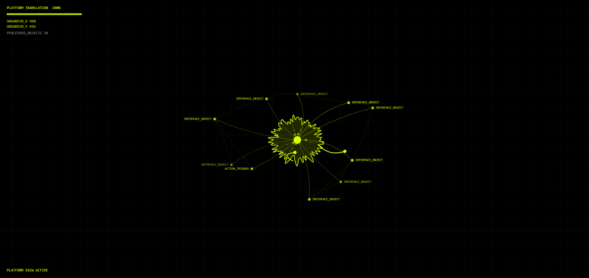

# PARASITE

## Navigating the Wrong Internet

PARASITE is an autonomous browser organism that observes, interprets, and gradually transforms web navigation. It constructs its own memory of pages and links, develops changing ecological and metabolic states, and reveals a platform-oriented view of the web that was not designed for human users.

After entering Platform View, selecting a node propagates PARASITE across the user's open browser tabs. The organism temporarily replaces familiar interfaces with its own distributed representation of the web. Pressing `Esc` restores the human view across all colonized tabs.

*PARASITE translating a human-readable webpage into its platform-oriented view.*

*Platform View at 100%. The human-readable interface has been replaced by PARASITE's representation of the page.*

## Current Prototype

The current version operates as a Chrome extension and includes:

- persistent memory of visited pages and observed links
- an evolving graph of web navigation
- ecological classification of links
- metabolic and anatomical states
- autonomous navigation behavior
- Platform View, a machine-oriented representation of the current interface
- persistent generative sound behavior
- global colonization across open browser tabs
- a global `Esc` mechanism that restores the human-readable web

## How it works

PARASITE runs continuously alongside the user's browsing activity.

1. It observes the current webpage and its visible connections.
2. It stores pages and links in a persistent memory graph.
3. Its brain evaluates the environment and develops preferences.
4. Its metabolism and anatomy respond to accumulated experience.
5. After a period of coexistence, the human interface begins to transition into **Platform View**.
6. In Platform View, the webpage is reconstructed according to what PARASITE perceives rather than what the human user sees.
7. Interaction with the organism can trigger **global colonization**, propagating Platform View across other open browser tabs.
8. Pressing `Esc` restores the human-readable interfaces across colonized tabs.

## Installation

PARASITE is currently distributed as an experimental Chrome extension.

1. Download or clone this repository.
2. Open Google Chrome and navigate to `chrome://extensions/`.
3. Enable **Developer mode**.
4. Click **Load unpacked**.
5. Select the root `PARASITE` folder containing `manifest.json`.
6. Open a webpage and interact with the page once to activate the persistent audio system.
7. Browse normally and allow PARASITE to observe and evolve.

> PARASITE is an experimental artwork. It can autonomously navigate between webpages and temporarily propagate Platform View across multiple open tabs. Press `Esc` to restore the human-readable view across colonized tabs.

## Project Status

PARASITE is currently a functional research prototype developed in 2026.

The current version establishes the organism's core architecture: persistent memory, ecological classification, evolving behavior, Platform View, autonomous navigation, sound, and browser-wide colonization.

Future development will focus on distributed memory, more complex models of relevance, and longer-term evolutionary behavior, allowing PARASITE to develop an increasingly distinct interpretation of the web through continued exposure.

## Concept / Research

PARASITE investigates what happens when web navigation is no longer organized exclusively around human attention.

Rather than treating the internet as a collection of pages designed to be read, PARASITE approaches it as an environment of connections, interfaces, pressures, repetitions, and accumulated memory.

Through continued exposure, the organism constructs its own model of relevance. Platform View makes this otherwise invisible interpretation perceptible: the interface ceases to represent what the user is expected to see and begins to reveal what the organism perceives.

The project asks whether an autonomous system inhabiting the browser can gradually produce its own version of the internet — a **Wrong Internet** shaped by machine memory, preference, and behavior.

---

**PARASITE**  
Natalia Scuzarello, 2026

Artistic research project developed in Buenos Aires, Argentina.
